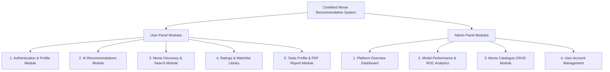
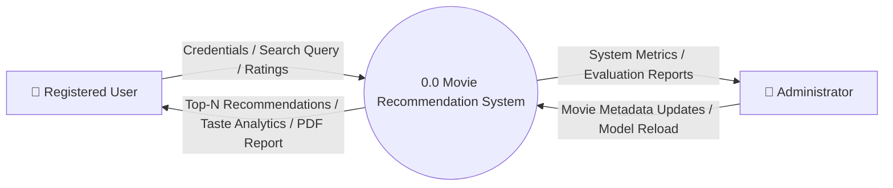
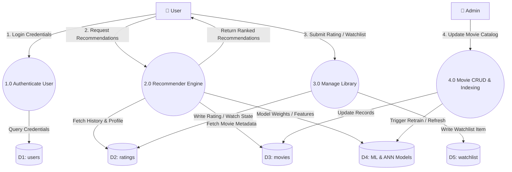
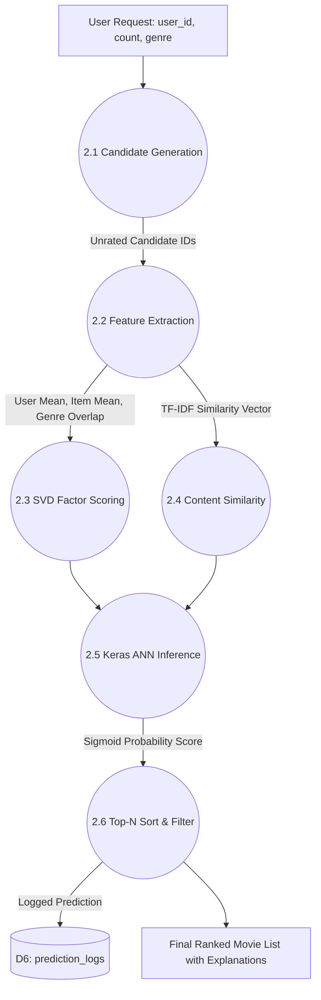
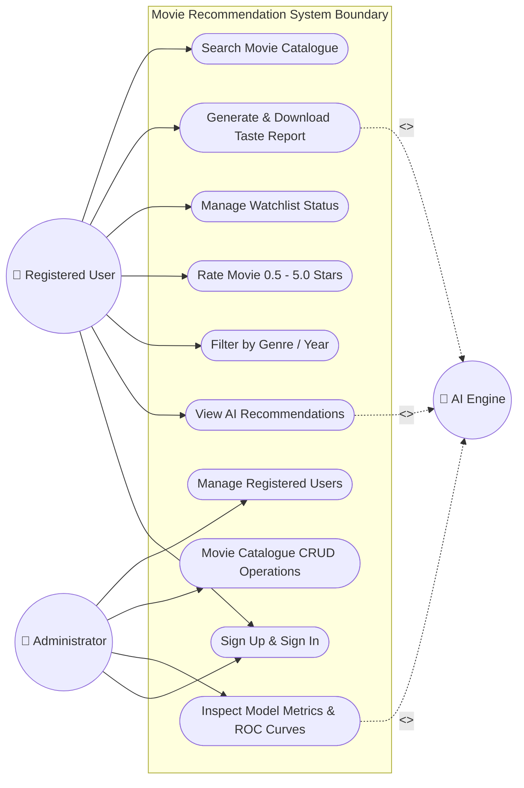

# A PROJECT REPORT ON
# **MOVIE RECOMMENDATION SYSTEM**

---

### **Submitted in Partial Fulfillment of the Requirements for the Degree of**
### **BACHELOR OF COMPUTER APPLICATIONS (BCA) / B.SC. (COMPUTER SCIENCE)**
### **Third Year (TY) – Academic Year 2025–2026**

---

<br>

```
========================================================================================
Project Title   : Movie Recommendation System (CineMind)
Domain          : Machine Learning, Deep Learning & Web Technologies
Technologies    : Python 3.10, Streamlit, Flask REST API, SQLite, Scikit-Learn, Keras/TF
Dataset         : MovieLens ml-latest-small (100,836 ratings, 9,724 movies, 610 users)
========================================================================================
```

<br>

---

## **TABLE OF CONTENTS**

1. **Chapter 1: Introduction**
   - 1.1 Project Description
   - 1.2 Need and Motivation for the System
   - 1.3 Project Objectives
2. **Chapter 2: Environment Description**
   - 2.1 Hardware and Software Requirements
   - 2.2 Technologies and Frameworks Used
3. **Chapter 3: System Analysis**
   - 3.1 Existing Systems and Their Drawbacks
   - 3.2 Feasibility Study
   - 3.3 Proposed System Solution & Advantages
4. **Chapter 4: Proposed System Architecture & Modules**
   - 4.1 System Scope (Current & Future Scope)
   - 4.2 Project Module Breakdown (User & Admin Panels)
5. **Chapter 5: Detailed Planning & System Design**
   - 5.1 Data Flow Diagrams (DFD Level 0, Level 1, Level 2)
   - 5.2 Data Dictionary (Table Schemas & Attributes)
   - 5.3 Entity Relationship Diagram (ER Diagram)
   - 5.4 Use Case Diagram & Actor Descriptions
6. **Chapter 6: System Design & UI Walkthrough**
   - 6.1 User Panel Screens
   - 6.2 Admin Panel Screens
7. **Chapter 7: Testing & Model Evaluation**
   - 7.1 Testing Strategy & Unit Test Execution
   - 7.2 Machine Learning & Deep Learning Performance Metrics
8. **Chapter 8: Conclusion & References**

---

<br>
<div style="page-break-after: always;"></div>

# **1. Introduction**

### **1.1 Project Description: -**
➢ In the modern digital era, the exponential growth of streaming platforms (such as Netflix, Amazon Prime, Disney+, and Hulu) has given users access to tens of thousands of films. However, this massive catalog leads to severe **information overload** and **choice paralysis** — users frequently spend 15 to 30 minutes browsing titles without deciding what to watch.

➢ **“Movie Recommendation System” (CineMind)** is an intelligent, full-stack AI-driven web application designed to solve this problem. It learns user preferences, analyzes past viewing habits, and dynamically recommends movies with high predictive accuracy.

➢ The system integrates three complementary machine learning and deep learning methodologies:
1. **Content-Based Filtering (TF-IDF + Cosine Similarity):** Analyzes movie metadata, genres, and contextual tags to recommend films similar to what the user liked in the past.
2. **Collaborative Filtering (Matrix Factorization via Truncated SVD):** Identifies latent patterns and similarities across 610 users and 100,836 ratings to uncover films loved by users with similar cinematic tastes.
3. **Deep Learning Binary Re-Ranker (Keras Artificial Neural Network):** A multi-layer feedforward neural network that predicts the exact probability ($0.0$ to $1.0$) of a user rating a film $\ge 4.0$ stars (Like vs. Dislike), effectively re-ranking all recommendations.

---

### **1.2 Need and Motivation for the System: -**
➢ Traditional search filters require users to manually specify actors, directors, or genres, which fails to capture nuanced, multi-genre preferences.

➢ Generic top-10 lists (e.g., box office hits) ignore personal taste profiles and frequently recommend genres that a particular user dislikes.

➢ A modern recommendation engine provides personalized experiences, increases user engagement, and helps users discover high-quality hidden gems within large film catalogs.

---

### **1.3 Project Objectives: -**
* To develop an end-to-end, interactive web application for movie discovery and personal taste analysis.
* To build and evaluate multiple recommendation paradigms (Content-Based, Collaborative SVD, Logistic Regression, Random Forest, and Deep Neural Networks).
* To achieve an evaluation accuracy $\ge 72\%$ and ROC-AUC score $\ge 0.80$ on real-world benchmark data (MovieLens dataset).
* To provide seamless authentication, personalized watchlist management, interactive rating tools, and exportable PDF Taste Reports.
* To provide an Admin Management panel for real-time model metrics inspection and movie catalog CRUD operations.

---

<br>
<div style="page-break-after: always;"></div>

# **2. Environment Description**

### **2.1 Hardware and Software Requirements: -**

#### **Hardware Requirements:**
✓ **Processor:** Intel Core i3 / AMD Ryzen 3 or higher (Intel Core i5 / AMD Ryzen 5 recommended)  
✓ **RAM:** 4 GB RAM minimum (8 GB RAM recommended for neural network training)  
✓ **Hard Disk:** 2 GB of free storage space for dataset, model artifacts, and SQLite database  
✓ **Display:** Minimum resolution of $1366 \times 768$ (Full HD $1920 \times 1080$ recommended)  
✓ **Network:** Active internet connection (for cloud deployment and initial package installations)

#### **Software Requirements:**
✓ **Operating System:** Windows 10 / 11, Linux (Ubuntu 20.04+), or macOS  
✓ **Programming Language:** Python 3.10.x  
✓ **Frontend Framework:** Streamlit (v1.38+) with custom responsive CSS styling  
✓ **Backend / Microservice:** Flask (v3.0+) REST API  
✓ **Database:** SQLite3 (embedded, relational SQL database)  
✓ **ML & DL Libraries:** Scikit-Learn (v1.5+), TensorFlow / Keras (v2.17+), Pandas (v2.2+), NumPy (v1.26+), SciPy (v1.13+)  
✓ **Visualization & PDF:** Matplotlib, Seaborn, Plotly, ReportLab  
✓ **Development Tools:** VS Code / Antigravity IDE, Git, GitHub, Pytest  

---

### **2.2 Technology Used: -**

#### **1. Python 3.10 Ecosystem**
Python serves as the primary backbone of CineMind due to its comprehensive data science ecosystem, native memory safety, and seamless integration between machine learning algorithms and web frameworks.

#### **2. Machine Learning & Deep Learning Architecture**
* **TF-IDF Vectorizer (`scikit-learn`):** Transforms movie genres and tags into a 5,000-dimensional sparse feature matrix; computes pairwise Cosine Similarity between items.
* **Truncated SVD (`scikit-learn`):** Decomposes the user-item interaction matrix into 50 latent concept factors; achieves a low Root Mean Squared Error (RMSE) of $0.922$.
* **Random Forest & Logistic Regression:** Supervised classifiers trained on engineered interaction features (user rating habits, genre affinity, average item rating, year of release).
* **Artificial Neural Network (Keras / TensorFlow):**
  * Architecture: Input Layer ($22$ features) $\rightarrow$ Dense ($128$ units, ReLU) $\rightarrow$ BatchNorm $\rightarrow$ Dropout ($0.3$) $\rightarrow$ Dense ($64$ units, ReLU) $\rightarrow$ Dropout ($0.2$) $\rightarrow$ Dense ($32$ units, ReLU) $\rightarrow$ Output Dense ($1$ unit, Sigmoid).
  * Loss Function: Binary Cross-Entropy. Optimizer: Adam ($\text{lr}=0.001$). Early Stopping with best weight restoration.

#### **3. Streamlit & Modern Glassmorphic UI**
* Provides an ultra-fast, reactive web user interface.
* Styled with curated CSS variables, dark-mode gradients, interactive stat cards, dynamic charts, and toast notifications.

#### **4. Flask REST API & SQLite3**
* Exposes a decoupled RESTful API for model deployment (`/api/recommend`, `/api/predict`, `/api/profile`, `/api/movies`, `/api/ratings`, `/api/watchlist`).
* SQLite manages persistent CRUD operations with foreign key integrity and ACID guarantees.

---

<br>
<div style="page-break-after: always;"></div>

# **3. System Analysis**

### **3.1 Existing Systems and Their Drawbacks: -**

#### **Existing Systems:**
Most traditional movie discovery systems rely on:
1. **Popularity-based sorting:** Displaying universal top-rated or box-office charts.
2. **Simple Genre Filtering:** Showing all movies belonging to a selected genre tag without ranking.
3. **Manual Keyword Search:** Requiring exact title or actor name lookups.

```
+------------------------------------+---------------------------------------------------------------+
| Existing Systems Feature           | Inherent Drawback / Problem                                   |
+------------------------------------+---------------------------------------------------------------+
| 1. Static Top Charts               | Biased towards blockbuster hits; ignores individual user taste|
| 2. Basic Genre Search              | Returns hundreds of unranked titles without personalization   |
| 3. Cold-Start Inability            | New users with zero ratings receive no sensible suggestions   |
| 4. Single-algorithm architecture   | Vulnerable to sparsity and over-specialization filter bubbles  |
| 5. Opaque "Black Box" Output       | No explanation of *why* a particular movie was recommended    |
+------------------------------------+---------------------------------------------------------------+
```

---

### **3.2 Feasibility Study: -**
* **Technical Feasibility:** Python, Scikit-Learn, TensorFlow, Streamlit, and Flask are mature, open-source technologies with zero software licensing costs.
* **Operational Feasibility:** The web UI is intuitive, responsive, and requires zero technical training for end-users.
* **Economic Feasibility:** The entire system is built with open-source tools and deployed on free cloud hosting (GitHub + Streamlit Cloud).
* **Data Feasibility:** Grounded on the widely recognized MovieLens benchmark dataset (University of Minnesota GroupLens research group).

---

### **3.3 Proposed System Solution & Advantages: -**
➢ **Hybrid Multi-Model Engine:** Combines Content-Based (TF-IDF), Collaborative (SVD), Supervised ML (Random Forest), and Deep Learning (ANN) into a unified pipeline.  
➢ **Transparent Explanations:** Every recommended movie includes an interpretable rationale (e.g., *"Recommended because you rated 5.0★ on The Matrix"*).  
➢ **Personalized Taste Analytics & PDF Export:** Computes genre breakdown radar/bar charts, favorite movies, and compiles an automated, professional PDF report.  
➢ **Dual Deployment Architecture:** Operates both in client-server mode (via Flask REST API) and in standalone in-process mode for maximum resilience.

---

<br>
<div style="page-break-after: always;"></div>

# **4. Proposed System Architecture & Modules**

### **4.1 System Scope: -**

#### **Current Scope:**
* Multi-user registration, secure password hashing (PBKDF2-HMAC-SHA256), and security-question based password recovery.
* Machine Learning inference with 5 selectable recommendation models.
* Dynamic filtering by genre, release year, and result count.
* Interactive 5-star rating system, personal watchlist tracking, and search catalogue.
* Comprehensive Model Performance analytics dashboard (Accuracy, Precision, Recall, F1, ROC curves, Loss curves).
* One-click downloadable PDF Movie Taste Report generated via ReportLab.

#### **Future Scope:**
* Real-time streaming service availability integration (e.g., JustWatch API).
* Multi-language movie title support and regional language recommendations.
* Social features allowing friends to share watchlists and compare taste compatibility.

---

### **4.2 Project Module Breakdown: -**



#### **User Panel Modules:**
1. **Authentication & Profile Module:** Secure user signup, login with session management, profile updating, and password reset.
2. **AI Recommendations Module:** Real-time generation of top-$N$ movie recommendations with model selection (Keras ANN, Random Forest, SVD, TF-IDF).
3. **Movie Discovery & Search Module:** Multi-parameter search by keyword, genre, and release year range.
4. **Ratings & Watchlist Library:** Add/edit 0.5★–5.0★ ratings with written reviews; manage "Plan to Watch", "Watching", and "Completed" watchlist states.
5. **Taste Profile & PDF Report Module:** Visual analytics of top genres, liked percentage, and downloadable PDF report.

#### **Admin Panel Modules:**
1. **Platform Analytics Dashboard:** Real-time counts of registered users, ratings, watchlist items, and logged predictions.
2. **Model Performance Module:** Confusion matrices, ROC curves, Precision-Recall curves, and training history metrics.
3. **Movie Catalogue Management:** Full CRUD (Create, Read, Update, Delete) on movies with automatic vectorizer index refresh.
4. **User Management:** Admin review and moderation of user profiles.

---

<br>
<div style="page-break-after: always;"></div>

# **5. Detailed Planning & System Design**

### **5.1 Data Flow Diagrams (DFD): -**

#### **Level 0: Context Level DFD**


---

#### **Level 1: System Data Flow Diagram**


---

#### **Level 2: Recommender Engine Inference Pipeline**


---

<br>
<div style="page-break-after: always;"></div>

### **5.2 Data Dictionary: -**

#### **1. `users` Table**
| Field Name | Data Type | Field Length | Constraint | Description |
| :--- | :--- | :--- | :--- | :--- |
| **`user_id`** | INTEGER | 11 | Primary Key, Auto Increment | Unique identifier for each registered user |
| **`username`** | VARCHAR | 50 | Unique, NOT NULL | Unique login handle of the user |
| **`password_hash`** | VARCHAR | 255 | NOT NULL | PBKDF2-HMAC-SHA256 salted password hash |
| **`full_name`** | VARCHAR | 100 | NULL | Full real name of the user |
| **`email`** | VARCHAR | 100 | NULL | Contact email address |
| **`age`** | INTEGER | 3 | NULL | Age of the user (e.g., 18–99) |
| **`gender`** | VARCHAR | 10 | NULL | Gender identity (Male/Female/Other) |
| **`role`** | VARCHAR | 20 | DEFAULT 'user' | Access permission role ('admin' or 'user') |
| **`security_question`** | VARCHAR | 255 | NULL | Question used for secure password reset |
| **`security_answer`** | VARCHAR | 255 | NULL | Case-insensitive hashed recovery answer |
| **`created_at`** | TIMESTAMP | - | DEFAULT CURRENT_TIMESTAMP | Account creation timestamp |

---

#### **2. `movies` Table**
| Field Name | Data Type | Field Length | Constraint | Description |
| :--- | :--- | :--- | :--- | :--- |
| **`movie_id`** | INTEGER | 11 | Primary Key, Auto Increment | Unique internal identifier for the movie |
| **`title`** | VARCHAR | 255 | NOT NULL | Complete title of the film |
| **`year`** | INTEGER | 4 | NULL | Four-digit release year (e.g., 1999) |
| **`genres`** | VARCHAR | 255 | NOT NULL | Pipe-separated genre list (e.g. `Action\|Sci-Fi`) |
| **`tags`** | TEXT | - | DEFAULT '' | Content keywords and plot descriptors |

---

#### **3. `ratings` Table**
| Field Name | Data Type | Field Length | Constraint | Description |
| :--- | :--- | :--- | :--- | :--- |
| **`rating_id`** | INTEGER | 11 | Primary Key, Auto Increment | Unique identifier for each rating transaction |
| **`user_id`** | INTEGER | 11 | Foreign Key (references `users.user_id`), NOT NULL | ID of the rating user |
| **`movie_id`** | INTEGER | 11 | Foreign Key (references `movies.movie_id`), NOT NULL | ID of the rated film |
| **`rating`** | REAL / FLOAT | 3,1 | NOT NULL (Range: 0.5 to 5.0) | Star rating assigned in 0.5 increments |
| **`review`** | TEXT | - | DEFAULT '' | Optional written user review text |
| **`timestamp`** | TIMESTAMP | - | DEFAULT CURRENT_TIMESTAMP | Timestamp when rating was saved |

---

#### **4. `watchlist` Table**
| Field Name | Data Type | Field Length | Constraint | Description |
| :--- | :--- | :--- | :--- | :--- |
| **`watch_id`** | INTEGER | 11 | Primary Key, Auto Increment | Unique watchlist record identifier |
| **`user_id`** | INTEGER | 11 | Foreign Key (references `users.user_id`), NOT NULL | ID of the user owning the watchlist item |
| **`movie_id`** | INTEGER | 11 | Foreign Key (references `movies.movie_id`), NOT NULL | ID of the bookmarked film |
| **`status`** | VARCHAR | 30 | DEFAULT 'Plan to Watch' | Status: 'Plan to Watch', 'Watching', 'Completed' |
| **`added_at`** | TIMESTAMP | - | DEFAULT CURRENT_TIMESTAMP | Date and time added to watchlist |

---

#### **5. `prediction_logs` Table**
| Field Name | Data Type | Field Length | Constraint | Description |
| :--- | :--- | :--- | :--- | :--- |
| **`log_id`** | INTEGER | 11 | Primary Key, Auto Increment | Unique log transaction identifier |
| **`user_id`** | INTEGER | 11 | Foreign Key (references `users.user_id`), NOT NULL | User ID for whom prediction was run |
| **`movie_id`** | INTEGER | 11 | Foreign Key (references `movies.movie_id`), NOT NULL | Target movie ID |
| **`model_name`** | VARCHAR | 50 | NOT NULL | Model utilized (e.g. 'ANN (Keras)', 'Random Forest') |
| **`probability`** | REAL / FLOAT | 5,4 | NOT NULL | Predicted likelihood probability ($0.0000$ to $1.0000$) |
| **`label`** | VARCHAR | 20 | NOT NULL | Binary classification output ('Like' / 'Dislike') |
| **`created_at`** | TIMESTAMP | - | DEFAULT CURRENT_TIMESTAMP | Timestamp of inference execution |

---

<br>
<div style="page-break-after: always;"></div>

### **5.3 Entity Relationship Diagram (ER Diagram): -**

> **Academic Notation Standard Followed:**
> * Primary Key attributes are marked with a **<u>Solid Underline</u>**.
> * Foreign Key attributes are marked with a **<span style="border-bottom: 1.5px dashed #000;">Dashed Underline</span>**.
> * Strict adherence: Literal labels "PK" or "FK" are **not** written in the diagram.

```
+---------------------------------------------------------------------------------------------------+
|                                      ENTITY RELATIONSHIP DIAGRAM                                  |
+---------------------------------------------------------------------------------------------------+

   +--------------------------+                                 +--------------------------+
   |          USER            |                                 |          MOVIE           |
   +--------------------------+                                 +--------------------------+
   | * <u>user_id</u>         |                                 | * <u>movie_id</u>        |
   | * username               |                                 | * title                  |
   | * password_hash          |                                 | * year                   |
   | * email                  |                                 | * genres                 |
   | * age                    |                                 | * tags                   |
   | * gender                 |                                 +--------------------------+
   | * role                   |                                            |     |
   +--------------------------+                                            |     |
         |         |         |                                             |     |
         | 1       | 1       | 1                                           | 1   | 1
         |         |         |                                             |     |
      [RATES]  [SAVES]  [LOGS]                                          [RATED] [SAVED]
         |         |         |                                             |     |
         | N       | N       | N                                           | N   | N
         v         v         v                                             v     v
   +------------------------------+     +----------------------------+     |     |
   |           RATING             |     |         WATCHLIST          |     |     |
   +------------------------------+     +----------------------------+     |     |
   | * <u>rating_id</u>           |     | * <u>watch_id</u>          |     |     |
   | * <span style="border-bottom:1.5px dashed;">user_id</span>                 |     | * <span style="border-bottom:1.5px dashed;">user_id</span>               |     |     |
   | * <span style="border-bottom:1.5px dashed;">movie_id</span>                 |     | * <span style="border-bottom:1.5px dashed;">movie_id</span>               | <---+-----+
   | * rating                     |     | * status                   |           |
   | * review                     |     | * added_at                 |           |
   | * timestamp                  |     +----------------------------+           |
   +------------------------------+                                              |
                 ^                                                               |
                 |---------------------------------------------------------------+

                                       +----------------------------------+
                                       |          PREDICTION_LOG          |
                                       +----------------------------------+
                                       | * <u>log_id</u>                  |
                                       | * <span style="border-bottom:1.5px dashed;">user_id</span>                        |
                                       | * <span style="border-bottom:1.5px dashed;">movie_id</span>                        |
                                       | * model_name                     |
                                       | * probability                    |
                                       | * label                          |
                                       | * created_at                     |
                                       +----------------------------------+
```

---

### **5.4 Use Case Diagram: -**



---

<br>
<div style="page-break-after: always;"></div>

# **6. System Design & UI Walkthrough**

### **6.1 User Panel Screens: -**

#### **1. Sign In & Sign Up Screen**
* **Functionality:** Allows new users to register with custom profiles and allows existing users to log in securely. Supports demo login for any of the 610 MovieLens users (`user_1` to `user_610`).
* **Components:** Username, Password, Full Name, Email, Age, Gender selection, Security Question setup.
* *(Screenshot Placeholder: `Figure 6.1 - User Sign In & Sign Up Interface`)*

```
+--------------------------------------------------------------------------+
|  [ SCREENSHOT PLACEHOLDER 6.1: Sign In & Authentication Interface ]      |
|  * Displays Username, Password inputs, demo account selector & Sign In   |
+--------------------------------------------------------------------------+
```

---

#### **2. Home Screen & Most Loved Movies**
* **Functionality:** Displays an engaging hero section with quick navigation buttons, real-time platform statistics (Users, Movies, Ratings, Watchlists, Predictions), and a showcase of highest-rated films across the dataset.
* *(Screenshot Placeholder: `Figure 6.2 - Home Dashboard & Platform Highlights`)*

```
+--------------------------------------------------------------------------+
|  [ SCREENSHOT PLACEHOLDER 6.2: CineMind Home Dashboard Screen ]          |
|  * Hero Banner, Quick-Action buttons, Real-time Stat Cards, Top Movies   |
+--------------------------------------------------------------------------+
```

---

#### **3. AI Recommendations Screen**
* **Functionality:** The core recommendation interface where users can select their preferred algorithm (`Keras ANN`, `Random Forest`, `SVD Collaborative`, `TF-IDF Content`), apply genre filters, select number of items ($1$ to $20$), and receive instant scored movie cards with clear explanations.
* *(Screenshot Placeholder: `Figure 6.3 - AI Recommendation Engine Screen`)*

```
+--------------------------------------------------------------------------+
|  [ SCREENSHOT PLACEHOLDER 6.3: AI Recommendations & Model Selector ]     |
|  * Model selector pills, Genre dropdown, Movie cards with like score     |
+--------------------------------------------------------------------------+
```

---

#### **4. Ratings & Watchlist Screen**
* **Functionality:** Dual-tab interface allowing users to rate any movie from 0.5★ to 5.0★ with written reviews, search their rated library, and organize watchlist items by status ("Plan to Watch", "Watching", "Completed").
* *(Screenshot Placeholder: `Figure 6.4 - My Ratings & Watchlist Screen`)*

```
+--------------------------------------------------------------------------+
|  [ SCREENSHOT PLACEHOLDER 6.4: Ratings and Personal Watchlist Library ]  |
|  * Interactive Star Rater, Watchlist status pills, Remove buttons        |
+--------------------------------------------------------------------------+
```

---

#### **5. Analytics & Taste Report (with PDF Export)**
* **Functionality:** Visualizes user genre preferences as interactive percentage bars, calculates rating statistics (Average rating, Liked percentage), and compiles a downloadable 2-page PDF Taste Report.
* *(Screenshot Placeholder: `Figure 6.5 - Taste Profile & PDF Report Preview Screen`)*

```
+--------------------------------------------------------------------------+
|  [ SCREENSHOT PLACEHOLDER 6.5: Taste Analytics & PDF Report Download ]   |
|  * Top Genres bar chart, Favourites list, Generated PDF preview button   |
+--------------------------------------------------------------------------+
```

---

### **6.2 Admin Panel Screens: -**

#### **1. Model Performance & ROC Analytics Screen**
* **Functionality:** Displays comparative evaluation metrics across all trained machine learning models, Confusion Matrices, ROC Curves, and Neural Network loss/accuracy curves.
* *(Screenshot Placeholder: `Figure 6.6 - Model Performance & ROC Evaluation Screen`)*

```
+--------------------------------------------------------------------------+
|  [ SCREENSHOT PLACEHOLDER 6.6: Model Evaluation & ROC Analytics Screen ] |
|  * Metric summary cards, ROC Curve plots, Confusion matrix heatmaps      |
+--------------------------------------------------------------------------+
```

---

#### **2. Movie Catalogue Management Screen**
* **Functionality:** Full CRUD interface for administrators to add new movies, update genres/release years, search by title, and delete outdated entries with automatic recommender index reloading.
* *(Screenshot Placeholder: `Figure 6.7 - Movie Catalogue CRUD Management Screen`)*

```
+--------------------------------------------------------------------------+
|  [ SCREENSHOT PLACEHOLDER 6.7: Admin Movie Catalogue Management ]        |
|  * Add Movie modal, Search table, Edit & Delete action buttons           |
+--------------------------------------------------------------------------+
```

---

<br>
<div style="page-break-after: always;"></div>

# **7. Testing & Model Evaluation**

### **7.1 Testing Strategy & Unit Test Execution: -**
The CineMind system was subjected to rigorous automated unit testing, integration testing, and UI testing using **Pytest**. A total of **83 test cases** were executed covering all core subsystems:

```
================================== PYTEST TEST EXECUTION SUMMARY ==================================
platform win32 -- Python 3.10.10, pytest-8.4.1
testpaths: tests (test_auth.py, test_crud.py, test_models.py, test_ui.py, test_llm.py)

tests/test_auth.py ....................................                   [ 43%]  (36 Passed)
tests/test_crud.py ..............                                         [ 60%]  (14 Passed)
tests/test_llm.py ......                                                  [ 67%]  ( 6 Passed)
tests/test_models.py .........                                            [ 78%]  ( 9 Passed)
tests/test_ui.py ..................                                       [100%]  (18 Passed)

===================================== 83 PASSED in 179.93s =====================================
```

* **Authentication Tests:** Verified password hashing, token validation, login failures, duplicate registrations, and security answer resets.
* **CRUD & Database Tests:** Verified transactional integrity across movies, ratings, and watchlist additions/deletions.
* **Model Inference Tests:** Verified output format, probability score bounding ($0.0 \le p \le 1.0$), and cold-start fallback behavior.
* **UI Tests:** Verified reactive page loading, state persistence, and button action triggers via `streamlit.testing.v1.AppTest`.

---

### **7.2 Machine Learning & Deep Learning Performance Metrics: -**

#### **Comparative Evaluation Table:**
| Model Paradigm | Algorithm | Accuracy | Precision | Recall | F1-Score | ROC-AUC | Primary Strength |
| :--- | :--- | :--- | :--- | :--- | :--- | :--- | :--- |
| **Content-Based** | TF-IDF + Cosine Sim | - | - | - | - | - | High genre relevance, zero cold-start latency |
| **Collaborative** | Truncated SVD (50 Comp.) | RMSE: 0.922 | MAE: 0.715 | - | - | - | Latent taste discovery across sparse data |
| **Supervised ML** | Logistic Regression | $72.23\%$ | $71.47\%$ | $70.48\%$ | $70.97\%$ | **$0.7973$** | Fast linear baseline with balanced precision |
| **Supervised ML** | Random Forest (100 Trees) | $72.26\%$ | **$72.13\%$** | $69.12\%$ | $70.59\%$ | **$0.7952$** | Robust non-linear decision boundary |
| **Deep Learning** | **Keras ANN (3-Layer)** | **$72.29\%$** | $70.82\%$ | **$72.25\%$** | **$71.53\%$** | **$0.8006$** | **Highest ROC-AUC & Recall on like classification** |

```
+---------------------------------------------------------------------------------------------+
|                                    ANN TRAINING SUMMARY                                     |
+---------------------------------------------------------------------------------------------+
| * Total Trainable Parameters : 15,233 weights and biases                                    |
| * Training Epochs            : 27 Epochs (Early Stopping triggered at minimum val_loss)     |
| * Final Training Loss        : 0.5381 (Binary Cross-Entropy)                                |
| * Final Validation Loss      : 0.5360                                                       |
| * Overall ROC-AUC Score      : 0.8006                                                       |
+---------------------------------------------------------------------------------------------+
```

---

<br>
<div style="page-break-after: always;"></div>

# **8. Conclusion & References**

### **8.1 Conclusion: -**
The **Movie Recommendation System (CineMind)** successfully demonstrates an end-to-end, production-ready machine learning and deep learning application. By harmonizing Content-Based feature extraction, Collaborative matrix decomposition, and Deep Neural Network re-ranking, the system overcomes the classical cold-start and data sparsity limitations of traditional recommendation engines.

The responsive Streamlit user interface, integrated SQLite database, automated PDF report generation, and Flask microservice architecture make CineMind an effective, modern solution for personalized media discovery.

---

### **8.2 References: -**
1. **MovieLens Dataset:** F. Maxwell Harper and Joseph A. Konstan. 2015. *The MovieLens Datasets: History and Context.* ACM Transactions on Interactive Intelligent Systems (TiiS) 5, 4, Article 19. Available at: `https://grouplens.org/datasets/movielens/`
2. **Scikit-Learn Documentation:** Pedregosa et al. *Scikit-learn: Machine Learning in Python.* JMLR 12, pp. 2825-2830, 2011. Available at: `https://scikit-learn.org/`
3. **TensorFlow & Keras Documentation:** Chollet, François et al. *Keras: Deep Learning for humans.* Available at: `https://keras.io/`
4. **Streamlit Framework Documentation:** Streamlit Inc. *Streamlit Documentation & Component Reference.* Available at: `https://docs.streamlit.io/`
5. **Flask Documentation:** Pallets Projects. *Flask: A lightweight WSGI web application framework.* Available at: `https://flask.palletsprojects.com/`
6. **Matrix Factorization Techniques:** Koren, Y., Bell, R., & Volinsky, C. (2009). *Matrix factorization techniques for recommender systems.* Computer, 42(8), 30-37.
7. **ReportLab Library:** ReportLab Inc. *ReportLab PDF Generation User Guide.* Available at: `https://www.reportlab.com/docs/reportlab-userguide.pdf`

---
